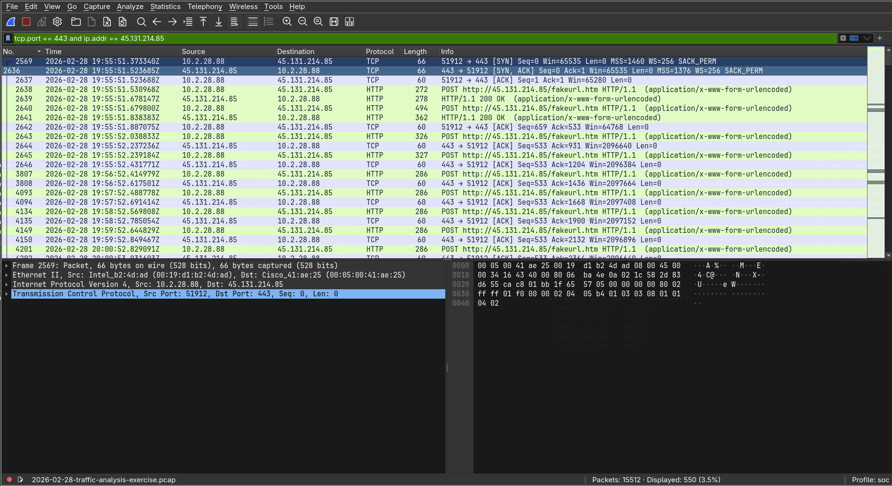
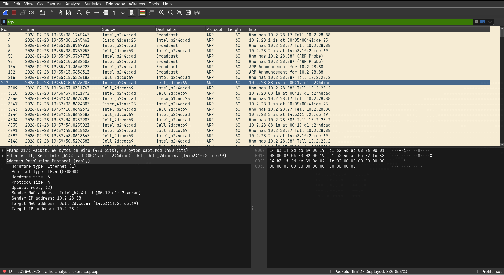
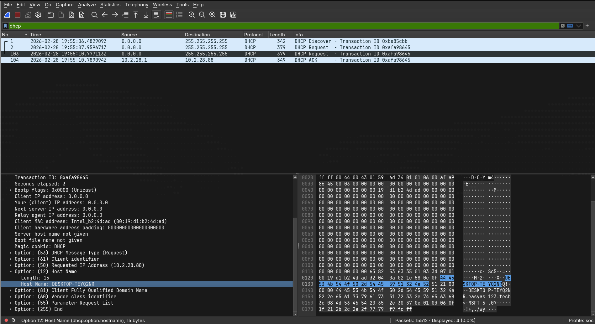
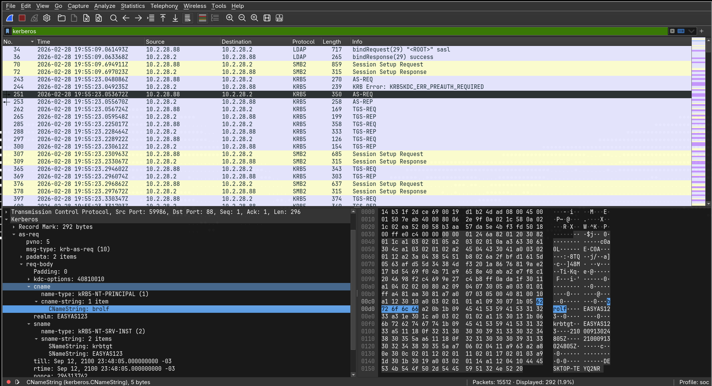
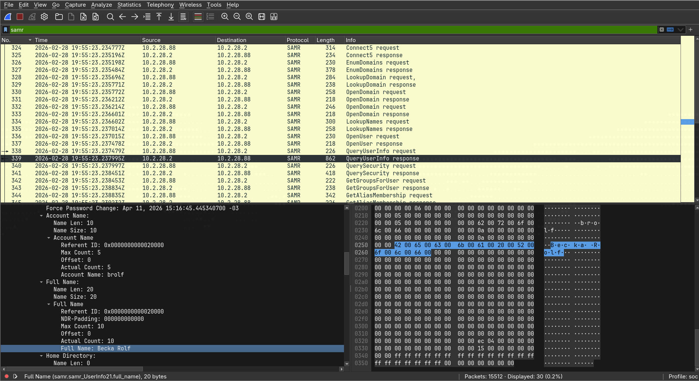

# Lab 01 — [Análise de Tráfego]

|                      |                                        |
| -------------------- | -------------------------------------- |
| **Data**             | 20-10-2026                             |
| **Categoria**        | Análise de tráfego / Redes / Wireshark |
| **Ferramentas**      | Wireshark                              |
| **Dificuldade**      | Média                                  |
| **Fonte do cenário** | malware-traffic-analysis.net           |

---

## 1. Resumo executivo

> Você é analista de SOC e o SIEM disparou várias assinaturas de NetSupport Manager RAT vindas de 45.131.214.85 pela porta TCP 443, com a atividade começando em 2026-02-28 às 19:55 UTC. Você puxou o PCAP do IP interno que gerou os alertas e precisa escrever um relatório de incidente para que alguém localize a máquina infectada e interrompa a atividade.

## 2. Objetivo

O relatório precisa responder: o IP do cliente Windows infectado, o MAC dele, o hostname, o nome da conta de usuário e o nome completo do dono dessa conta.

## 3. Ambiente

- Arquivo baixado: 2026-02-28-traffic-analysis-exercise.pcap.zip
- Ferramentas e versões: Wireshark
- Download e Unzip do arquivo necessários.

## 4. Execução / Investigação

### 4.1 [IP]

Após abrir o arquivo .pcap, fui ler o enunciado pra ver do que se tratava o problema e identifiquei três pontos principais.

1 - O ataque era um NetSupport Manager RAT que pesquisando, descobri que é: O **NetSupport Manager RAT** é o uso malicioso do **NetSupport Manager**, um software comercial legítimo de monitoramento e administração remota de computadores.

Com os dados do enunciado, eu consigo montar um filtro e aplicar ele no Wireshark pra uma melhor análise:  tcp.port == 443 and ip.addr == 45.131.214.85.

2 - O host **10.2.28.88** iniciou conexões de saída para o servidor de C2 **45.131.214.85:443**, comportamento compatível com beaconing de RAT. Provavelmente a máquina tinha algum malware e o ataque veio de dentro da rede corporativa.

Numa rede corporativa, o firewall e o NAT bloqueiam quase toda conexão que **entra** vinda da internet. Se o atacante tentasse se conectar direto ao 10.2.28.88, nem conseguiria alcançar o IP, que é privado. Já conexões que **saem** para a porta 443 são liberadas, porque é por ali que todo mundo acessa sites HTTPS.

3 - O ip do servidor C2 é **45.131.214.85** e o ip da máquina infectada é o **10.2.28.88**. Com isso, já mato a primeira questão, que era descobrir o ip da máquina infectada.

### 4.2 [MAC]

Para responder a segunda questão, eu preciso identificar o MAC dessa máquina infectada, o que não é muito difícil a partir do momento que descobri o IP dessa máquina.

Utilizando o filtro 'arp' no Wireshark, consigo ver todas as requisições ARP realizadas nessa rede. Os campos ''...is at...'' vão me fornecer o MAC da máquina infectada. 

No pacote 216 o ip 10.2.28.2 pergunta quem é o ip 10.2.28.88, e o ele responde com 10.2.28.88 is at 00:19:d1:b2:4d:ad, logo, tenho a conclusão de que o MAC da máquina infectada é este, concluido o segundo desafio.

### 4.3 [Hostname]

O próximo passo é descobrir o hostname. Utilizei o filtro 'dhcp' e acabei encontrando uma máquina tentando requisitar um ip na rede. No campo Client MAC adress, apareceu que tal máquina é nossa máquina infectada, e eu provei isso verificando o MAC descoberto anteriormente (00:19:d1:b2:4d:ad).

Como o MAC bateu, fui verificar o campo Option: (12) Host Name e lá apareceu o hostname dessa máquina - DESKTOP-TEYQ2NR, concluindo assim o terceiro desafio.

### 4.4 [Usuário]

O próximo passo é descobrir a conta de usuário. Utilizei o filtro 'kerberos', já que, em um ambiente Active Directory, o login do usuário no domínio passa pelo controlador de domínio através desse protocolo. Entre os pacotes, encontrei uma requisição AS-REQ enviada pela nossa máquina infectada (10.2.28.88) ao controlador de domínio (10.2.28.2), o que confirmei pelo IP de origem do pacote.

O AS-REQ é o primeiro pedido de autenticação do login, e nele o nome da conta precisa ir em texto claro para que o controlador de domínio saiba qual credencial validar. Por isso, expandi os campos `req-body` → `cname` → `cname-string` e, no campo `CNameString`, apareceu a conta **brolf**.

Para garantir que se tratava de uma conta de usuário, e não da conta da própria máquina, verifiquei três pontos: o nome não termina com `$` (padrão das contas de computador no AD), o `name-type` é KRB5-NT-PRINCIPAL e o `realm` é EASYAS123, o mesmo domínio informado no cenário. Além disso, o serviço solicitado (`sname`) é o `krbtgt`, o que indica que esse pacote corresponde ao próprio login do usuário no domínio, concluindo assim o quarto desafio.

### 4.4 [Nome completo]

O próximo passo é descobrir o nome completo do usuário. Inicialmente, tentei encontrá-lo no protocolo LDAP, que é utilizado para consultar o diretório do Active Directory, onde ficam guardados atributos da conta como o nome completo. Porém, as consultas LDAP entre a máquina infectada (10.2.28.88) e o controlador de domínio (10.2.28.2) estavam cifradas, o que confirmei pela indicação `SASL GSS-API Privacy` na coluna Info e pela flag `Sealed: Set` no cabeçalho GSS-API, impedindo a leitura dos atributos.

Diante disso, verifiquei em **Statistics → Protocol Hierarchy** quais outros protocolos estavam presentes na captura e identifiquei o **SAMR** (Security Account Manager Remote), encapsulado em SMB2/DCE-RPC, que o Windows utiliza para consultar dados de contas diretamente no controlador de domínio. Utilizei o filtro `samr` e encontrei uma sequência de chamadas feitas pela máquina infectada (pacotes 324 a 353), em que ela localiza a conta `brolf` (`LookupNames`), abre a conta (`OpenUser`) e solicita seus dados (`QueryUserInfo`).

Na resposta do controlador de domínio a essa solicitação (pacote nº 339, `QueryUserInfo response`), o campo `Account Name` confirma a conta **brolf**, e o campo `Full Name`, logo abaixo, traz o nome completo do usuário: **Becka Rolf**, concluindo assim o quinto desafio.

## 5. Conclusão e recomendações

A partir dos alertas do SIEM indicando tráfego de NetSupport Manager RAT com o servidor 45.131.214.85 pela porta TCP 443, foi possível identificar na captura o host comprometido e o usuário associado a ele:

| Item                 | Valor             | Evidência                                                           |
| -------------------- | ----------------- | ------------------------------------------------------------------- |
| IP do host infectado | 10.2.28.88        | Conexões de saída para o C2; DHCP ACK (pacote nº 104)               |
| MAC                  | 00:19:d1:b2:4d:ad | Camada Ethernet II; DHCP Request (pacote nº 2)                      |
| Hostname             | DESKTOP-TEYQ2NR   | DHCP Options 12 e 81 (pacote nº 2); Kerberos AS-REQ (pacote nº 243) |
| Conta de usuário     | brolf             | Kerberos AS-REQ, campo `CNameString`                                |
| Nome completo        | Becka Rolf        | SAMR `QueryUserInfo response`, campo `Full Name` (pacote nº 339)    |

O host DESKTOP-TEYQ2NR iniciou as conexões com o servidor de C2, o que
caracteriza uma conexão reversa: o RAT instalado na máquina se comunica
para fora da rede, contornando o bloqueio de conexões de entrada do
firewall. O uso de um software comercial legítimo como o NetSupport
Manager dificulta a detecção, já que ele pode se passar por uma
ferramenta de administração remota comum.

A máquina obteve seu IP via DHCP às 19:55:06 UTC, no mesmo minuto em que
começaram os alertas do SIEM. Isso indica que o RAT já estava instalado
antes do início da captura e é executado automaticamente quando a
máquina inicia. O vetor de infecção inicial não foi determinado nesta
análise.

**Recomendações:**

- Isolar o host DESKTOP-TEYQ2NR (10.2.28.88) da rede.
- Bloquear o IP 45.131.214.85 no firewall e procurar outros hosts
  que tenham se comunicado com ele.
- Redefinir as credenciais da conta brolf, já que o atacante pode ter
  tido acesso à sessão da usuária.
- Investigar o mecanismo de persistência e o vetor de infecção inicial
  no próprio host (análise forense do endpoint).

## 9. Lições aprendidas

- **Partir do alerta e pivotar.** O IP do C2 informado pelo SIEM foi o
  ponto de partida. A partir dele encontrei o IP interno, depois o MAC,
  o hostname e o usuário, usando cada dado descoberto para achar o
  próximo.

- **Cada informação tem um protocolo que a carrega.** DHCP e ARP
  mostram IP e MAC; DHCP, NBNS e Kerberos mostram o hostname; Kerberos
  mostra a conta de usuário; LDAP e SAMR mostram dados do diretório,
  como o nome completo.

- **Contas com `$` são de máquina.** No Kerberos aparecem tanto contas
  de computador quanto de pessoas, e o `$` no final do nome é o que
  diferencia as duas.

- **Protocolos de autenticação protegem o segredo, não a identidade.**
  No Kerberos, a senha nunca trafega pela rede, mas o nome da conta vai
  em texto claro, porque o controlador de domínio precisa saber qual
  credencial validar.

- **Quando uma fonte está cifrada, procure outra.** O LDAP estava
  selado (`Sealed: Set`), mas a mesma informação estava legível no
  SAMR. A Protocol Hierarchy foi essencial para descobrir quais
  protocolos existiam na captura.

- **Confirmar com mais de uma fonte.** O hostname foi confirmado no
  DHCP (duas opções diferentes) e no Kerberos, o que deixa a evidência
  mais sólida do que um único pacote.

- **Ajustar o tempo para UTC.** Os alertas do SIEM estavam em UTC, e
  configurar o Wireshark no mesmo fuso evitou erros na linha do tempo.
