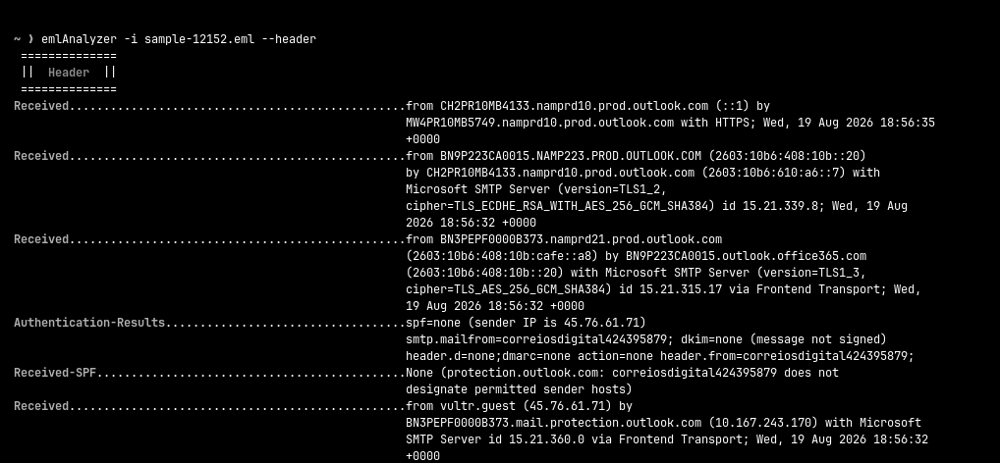
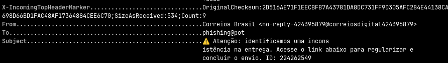
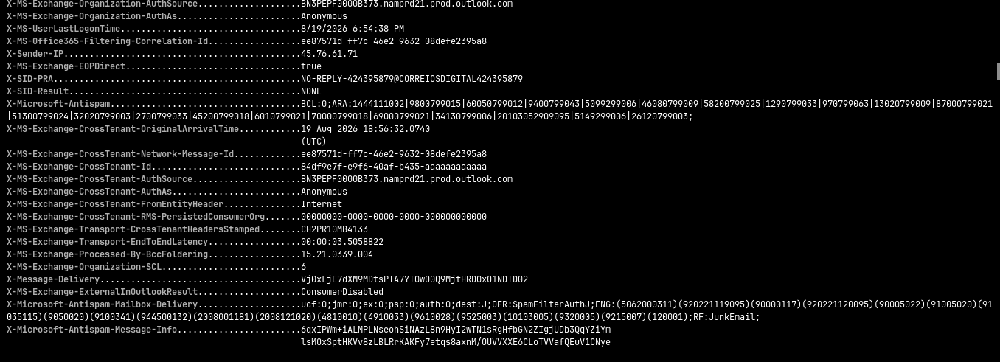
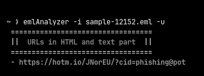
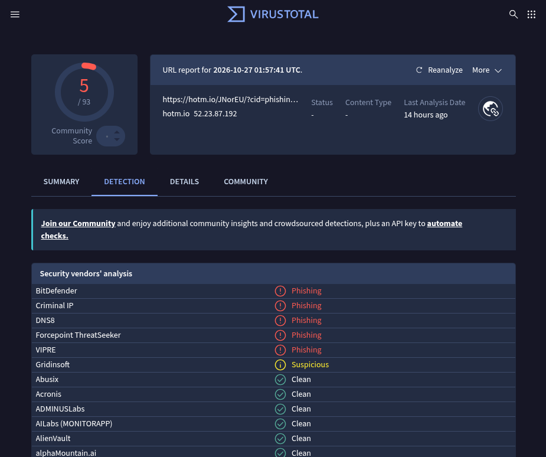

# Lab 02 — Análise de Phishing

|                      |                                                                          |
| -------------------- | ------------------------------------------------------------------------ |
| **Data**             | 26/10/2026                                                               |
| **Categoria**        | Phishing  / Análise de E-mail                                            |
| **Ferramentas**      | less/nvim, eml-analyzer, whois, dig, VirusTotal, urlscan.io              |
| **Dificuldade**      | Média                                                                    |
| **Fonte do cenário** | `sample-12152.eml`, do phishing_pot (github.com/rf-peixoto/phishing_pot) |

---

## 1. Resumo executivo

> > E-mail se passando pelos Correios, reportado como suspeito por um usuário, foi analisado e confirmado como **phishing com objetivo de fraude financeira** (cenário simulado com amostra pública). A mensagem cobrava uma falsa taxa de entrega com prazo de 24 horas e direcionava a vítima a um link de pagamento. O envio partiu de um servidor alugado em um provedor de nuvem nos EUA, sem nenhuma autenticação e sem relação com o domínio oficial dos Correios. O link também carregava o e-mail do destinatário, permitindo ao atacante identificar quem clicou. Recomenda-se remover a mensagem de todas as caixas, bloquear os indicadores identificados, verificar se algum usuário acessou o link e alertar os colaboradores sobre a campanha.

## 2. Objetivo

Realizar a triagem de um e-mail de phishing real, como um analista de SOC faria com um e-mail reportado por um usuário: analisar cabeçalhos e autenticação (SPF, DKIM, DMARC), examinar o conteúdo e os links, extrair IOCs, consultar reputação e emitir um veredito com recomendações de resposta. O foco principal é responder quatro perguntas.. 1- É malicioso? 2 - O que ele tenta fazer? 3 - Quais são os indicadores? 4 - Qual passo a empresa deve tomar?

## 3. Ambiente

- Sistema: Omarchy 
- Ferramentas: less/nvim, eml-analyzer, whois, dig, VirusTotal, urlscan.io
- Amostra: `sample-12152.eml`, do phishing_pot (github.com/rf-peixoto/phishing_pot)
- SHA-256: feac32261add710855cb311d487c15c7da461406a3ef257cac0cc1337f6d2505 

## 4. Execução / Investigação

O principal comando que eu utilizei durante a maioria da análise foi da ferramenta emlAnalyzer:

```
emlAnalyzer -i sample-12152.eml 
```

Esse comando foi essencial em toda a minha investigação pois apenas com ele, já conseguimos descobrir muita coisa. Os seguintes passos explicarão tudo que pude encontrar, detectar e seus parâmetros de uso.


### 4.1 HTML

Comecei pelo conteúdo, para entender a isca e pra ver do que se trata e quais são os gatilhos. O comando que eu utilizei pra analisar o html foi:


```
emlAnalyzer -i sample-12152.eml --html
```


Analisando o conteúdo de texto desse email, percebemos que basicamente ele indica que algum pagamento ou taxa de um envio do correio não foi pago, e que se o destinatário não pagar, o pedido vai ser devolvido ao remetente sem reembolso.

O problema está no fato de que isso realmente pode acontecer. Alguns pedidos dos correio passam por algum acréscimo nas taxas ou frete e pode ser que tenha que realmente fazer um pagamento.

O que suspeita esse email é o fato de que essas pendências não necessitam clicar em link algum e sim são realizadas no portal do correio. Também é muito suspeito os gatilhos de urgência que dizem ''Ultimo prazo'', emojis de alerta e etc.

Por si só, o corpo não pode trazer um veredito final sobre ser um email falso ou não, mas o corpo com gatilhos de urgência e o gatilho de click em link suspeito acrescenta na nossa análise.

### 4.2 Origem e caminho do e-mail

#### 4.2.1 Leitura dos cabeçalhos `Received`

Para ver todos os cabeçalhos já decodificados, utilizei:

```
emlAnalyzer -i sample-12152.eml --header
```

Cada servidor que recebe o e-mail adiciona um cabeçalho `Received` no topo da mensagem, no formato `from A by B`: o servidor **B** registra que recebeu a mensagem vinda de **A**. Por isso, a leitura é feita **de baixo para cima**: o último `Received` do arquivo é o mais próximo da origem.



| Salto | Enviou (`from`) | Recebeu (`by`) | Horário (UTC) |
|---|---|---|---|
| 1 | `vultr.guest` (45.76.61[.]71) | BN3PEPF0000B373.mail.protection.outlook.com | 18:56:32 |
| 2 | BN3PEPF0000B373 | BN9P223CA0015 | 18:56:32 |
| 3 | BN9P223CA0015 | CH2PR10MB4133 | 18:56:32 |
| 4 | CH2PR10MB4133 | MW4PR10MB5749 | 18:56:35 |

Apenas o salto 1 vem de fora da Microsoft. Os saltos 2 a 4 são a transferência interna até a caixa do destinatário. Ou seja, o atacante enviou a mensagem **diretamente** do servidor dele para o servidor de entrada da Microsoft, sem nenhum intermediário. A entrega completa levou cerca de 3,5 segundos (`X-MS-Exchange-Transport-EndToEndLatency: 00:00:03.5`).

#### 4.2.2 Identificação da origem

O primeiro salto mostra que o e-mail foi enviado pelo IP **45.76.61[.]71**, que se apresentou com o nome **`vultr.guest`**.

O `vultr.guest` não é um domínio: é o nome que o servidor de envio anunciou ao se conectar (comando `HELO` do protocolo SMTP). Esse nome é declarado pelo próprio remetente e não é verificado. Já o IP não pode ser falsificado, pois a conexão de rede depende dele.

Para identificar o dono do IP, consultei o `whois`, o DNS reverso e o AbuseIPDB:

```
whois 45.76.61.71
dig -x 45.76.61.71 +short
```


- **whois:** o bloco `45.76.60.0/23` está atribuído à **Vultr Holdings, LLC** (empresa do grupo The Constant Company), um provedor de nuvem que aluga servidores virtuais (VPS).
- **DNS reverso:** o IP resolve para `45.76.61.71.vultrusercontent[.]com`, confirmando que se trata de uma VPS da Vultr.
- **AbuseIPDB:** uso classificado como *Data Center/Web Hosting*, ASN AS20473, localização Atlanta (EUA). Nenhuma denúncia registrada na data da consulta. Isso não indica que o IP é confiável, já que IPs de VPS são alugados e descartados com facilidade.

**Conclusão:** o atacante provavelmente contratou uma VPS na Vultr e enviou o e-mail diretamente dela, sem sequer alterar o nome padrão da máquina (`vultr.guest`). Os Correios não enviariam comunicações a partir de um servidor alugado em um provedor de nuvem nos EUA.

#### 4.2.3 Autenticação (SPF, DKIM e DMARC)

O servidor de entrada da Microsoft registrou o resultado das verificações de autenticação no cabeçalho `Authentication-Results` (o resultado do SPF também aparece separado no `Received-SPF`):

```
grep -iA6 '^authentication-results:' sample-12152.eml
```

| Verificação | Resultado | Significado |
|---|---|---|
| SPF | `none` | O domínio do remetente não publica registro SPF |
| DKIM | `none` | A mensagem não possui assinatura digital (*message not signed*) |
| DMARC | `none` | O domínio não possui política DMARC |

Para confirmar a ausência dos registros, consultei o DNS do domínio do remetente:

```
dig correiosdigital424395879 TXT +short
dig _dmarc.correiosdigital424395879 TXT +short
```

As duas consultas não retornaram nenhum resultado.

O resultado `none` é diferente de `fail`: ele não indica que o servidor foi recusado, e sim que **não existe nenhuma regra para verificar**. Na prática, nenhum dos três mecanismos comprova quem enviou a mensagem. Isso não faz o e-mail ser bloqueado por si só, mas reduz a confiança no remetente e contribui para a classificação como spam (ver seção 4.4).

> **Observação:** o domínio `correiosdigital424395879` não possui extensão (como `.com` ou `.br`). Isso pode ser efeito da anonimização aplicada pelo repositório phishing_pot.

#### 4.2.4 Message-ID e X-Mailer

```
grep -iE '^(message-id|x-mailer):' -A1 sample-12152.eml
```

O `Message-ID` da mensagem termina em `@BN3PEPF0000B373.namprd21.prod.outlook.com`, que é o **servidor de entrada da Microsoft** (o mesmo que recebeu o e-mail no salto 1). Normalmente, o Message-ID é criado pelo programa de quem envia. Aqui, o e-mail chegou **sem** Message-ID, e o próprio servidor da Microsoft gerou um ao recebê-lo. Por isso, o Message-ID não revela nada sobre a origem.

O cabeçalho `X-Mailer: Custom Mailer v1.0` indica que o envio foi feito por um programa personalizado, e não por um serviço de e-mail comum. A ausência do Message-ID original reforça essa conclusão: trata-se de um envio automatizado, típico de campanhas de phishing em massa.


### 4.3 From e To



Nos cabeçalhos `From`e `To`também podemos identificar algumas coisas muito interessantes. A primeira delas é que esse nome 'Correios Brasil' não deve ser levado a sério, pois o atacante pode mudar este nome. 

Também vi que o campo `To` contém `phishing@pot`, valor de anonimização aplicado pelo repositório phishing_pot no lugar do endereço real do destinatário. Pela saudação no corpo, o destinatário original era uma conta `@hotmail.com`.

O nome de exibição e o endereço também não batem.. o nome de exibição é Correios Brasil, mas o endereço é `no-reply-424395879@correiosdigital424395879` que não é `correios.com.br`.


### 4.4 X-MS



O cabeçalho `X-MS-Exchange-Organization-SCL` é um campo inserido pelo Microsoft Exchange (local ou online) que define a probabilidade de uma mensagem ser spam através do **SCL (_Spam Confidence Level_)**, utilizando uma escala de **-1 a 9**. Podemos analisar no nosso conteúdo que o nível foi 6, classificado como spam.

`X-Microsoft-Antispam-Mailbox-Delivery` esse cabeçalho confirma que o email foi entregue a caixa de spam/lixo-eletrônico do destinatário, podemos confirmar isso com `dest:J`, esse J é de Junk, ou seja, lixo-eletrônico.

Vale ressaltar que esse bloco, por si só, não confirma se esse e-mail é phishing ou não, mas ele complementa nossas suspeitas, visto que os servidores da Microsoft consideraram ele como spam.


### 4.5 O link

O próximo passo foi analisar aquele link que está no email. Para essa análise eu utilizei o comando:


```
emlAnalyzer -i sample-12152.eml -u
```




O e-mail contém **um único link**, associado ao botão “Regularizar Pagamento”. Concentrar toda a ação em um só botão é comum em phishing: deixa a mensagem simples e direciona a vítima para um único caminho.

Também verifiquei se o HTML carregava imagens ou pixels de rastreamento externos:

```
emlAnalyzer -i sample-12152.eml -x
```

Nenhum recurso externo foi encontrado. 

#### Estrutura do link

> `hxxps://hotm[.]io/JNorEU/?cid=phishing@pot`

| Parte     | Valor                      | Significado                                                                         |
| --------- | -------------------------- | ----------------------------------------------------------------------------------- |
| Protocolo | `hxxps` (https, desarmado) | Conexão criptografada. O cadeado no navegador **não** garante que o site é legítimo |
| Domínio   | `hotm[.]io`                | Encurtador de links da Hotmart, um serviço legítimo                                 |
| Caminho   | `/JNorEU/`                 | Identificador do link curto criado pelo atacante                                    |
| Parâmetro | `cid=phishing@pot`         | Endereço do destinatário, anonimizado na amostra                                    |

Podemos analisar que o link não aponta pra um domínio do atacante, e sim para o encurtador da Hotmart. Com isso, o atacante esconde o destino final da vítima e aproveita a boa reputação do serviço para dificultar o bloqueio por filtros de e-mail. Essa técnica é mapeada no MITRE ATT&CK como T1608.005 (Link Target).

O valor `phishing@pot` é a anonimização aplicada pelo repositório no lugar do endereço real, e o mesmo valor aparece no campo `To` e na saudação do corpo. Isso indica que o link original carregava o e-mail do destinatário. Assim, o atacante consegue identificar quem clicou e confirmar endereços ativos, que podem ser reutilizados em novos ataques.

Também decidi colocar a URL no site VirusTotal pra ver se encontrava algo:




(consulta em 26/10/2026)

O site por si só não traz um veredito final, mas ele complementa e muito a análise e parte a comprovar que este email é sim um email falso. Analisando o conteúdo, podemos concluir que é uma fraude financeira.

## 5. Linha do tempo

| Horário (UTC)       | Evento                                                                           |
| ------------------- | -------------------------------------------------------------------------------- |
| 19/08/2026 18:56:32 | VPS `45.76.61[.]71` entrega o e-mail ao servidor de entrada da Microsoft         |
| 19/08/2026 18:56:32 | Verificação SPF/DKIM/DMARC: todos `none`; SCL 6 atribuído                        |
| 19/08/2026 18:56:35 | E-mail entregue na pasta Lixo Eletrônico do destinatário (latência total ~3,5 s) |

## 6. Indicadores de comprometimento (IOCs)

| Tipo         | Valor                                                        | Contexto                                         |
| ------------ | ------------------------------------------------------------ | ------------------------------------------------ |
| IP de Origem | 45.76.61[.]71                                                | VPS Vultr (AS20473) que enviou o e-mail          |
| HELO         | vultr.guest                                                  | Nome padrão de VPS Vultr, não configurado        |
| Remetente    | no-reply-424395879@correiosdigital424395879                  | Endereço do `From` e `Return-Path`               |
| Reply-To     | suporte@notificacoes                                         | Para onde iriam as respostas                     |
| URL          | hxxps://hotm[.]io/JNorEU/                                    | Link do botão; encurtador legítimo abusado       |
| Assunto      | “⚠️ Atenção: identificamos uma inconsistência na entrega...” | Útil para buscar o mesmo e-mail em outras caixas |
| X-Mailer     | `Custom Mailer v1.0`\|                                       | Identifica o arquivo analisado                   |


## 7. Mapeamento MITRE ATT&CK

| Tática | Técnica | ID | Evidência |
|---|---|---|---|
| Resource Development | Acquire Infrastructure: Virtual Private Server | T1583.003 | Envio a partir de VPS da Vultr, com nome padrão `vultr.guest` (seção 4.2.2) |
| Resource Development | Stage Capabilities: Link Target | T1608.005 | Link curto criado no serviço legítimo `hotm[.]io` (seção 4.5) |
| Initial Access | Phishing: Spearphishing Link | T1566.002 | Botão "Regularizar Pagamento" com link para página externa (seção 4.5) |
| Defense Evasion | Impersonation | T1656 | Nome de exibição "Correios Brasil" e identidade visual imitando os Correios (seções 4.1 e 4.3) |


## 8. Conclusão e recomendações

### Veredito

**Verdadeiro positivo: phishing com objetivo de fraude financeira.**

O e-mail se passa pelos Correios para cobrar uma suposta taxa pendente de entrega, usando urgência ("prazo de 24 horas", "sem reembolso") para levar a vítima a clicar e pagar. As principais evidências:

1. Envio a partir de uma VPS alugada na Vultr, e não de servidores dos Correios.
2. Nome de exibição "Correios Brasil" com endereço sem nenhuma relação com `correios.com.br`.
3. Ausência total de autenticação (SPF, DKIM e DMARC `none`).
4. Link para encurtador de terceiros contendo o e-mail do destinatário, permitindo rastrear quem clicou.
5. URL classificada como phishing no VirusTotal.

Como objetivo secundário, o parâmetro `cid` permite ao atacante validar endereços ativos para ataques futuros.

O e-mail foi entregue na pasta de lixo eletrônico (SCL 6, `dest:J`), o que reduz, mas não elimina, o risco: usuários costumam verificar essa pasta em busca de mensagens esperadas.

### Ações de contenção

- **Buscar e remover** o mesmo e-mail de todas as caixas da organização, usando como critérios o assunto, o remetente, o IP de origem e a URL.
- **Bloquear** os IOCs da seção 6 no gateway de e-mail e a URL `hxxps://hotm[.]io/JNorEU/` no proxy ou filtro web.
- **Verificar nos logs de proxy e DNS** se algum usuário acessou a URL. Para cada usuário que clicou:
  - Entrar em contato para saber se houve pagamento ou se foram informados dados de cartão.
  - Em caso de pagamento via Pix, orientar a acionar o banco imediatamente para tentar a devolução pelo MED (Mecanismo Especial de Devolução).
  - Em caso de dados de cartão, orientar o bloqueio do cartão junto ao emissor.

### Ações de correção

- **Notificar os provedores abusados:** a Vultr (`abuse@vultr.com`), pela VPS usada no envio, e a Hotmart, pelo link encurtado.
- **Comunicar os usuários** sobre a campanha, reforçando que cobranças reais de importação dos Correios são feitas apenas no site ou aplicativo oficial, nunca por link recebido por e-mail.
- **Dar retorno ao usuário que reportou**, confirmando que era phishing. Isso incentiva novos reportes.

### Oportunidades de detecção

- Alertar sobre e-mails externos cujo **nome de exibição contém marcas conhecidas** (ex.: "Correios") e cujo domínio do remetente **não é o domínio oficial** da marca.
- Aumentar a pontuação de risco de mensagens com **SPF, DKIM e DMARC todos `none`** combinadas com termos de cobrança ou urgência.
- Sinalizar **links para encurtadores** que carregam o endereço do destinatário como parâmetro.
- Monitorar cabeçalhos que indicam envio automatizado, como `X-Mailer: Custom Mailer` e nomes HELO padrão de VPS (`vultr.guest`).


## 9. Lições aprendidas

- **Ler os cabeçalhos `Received`:** no começo, achei que `from A by B` significava que A tinha recebido de B. Entendi que é o contrário (B registra que recebeu de A) e que a leitura deve ser feita de baixo para cima. Depois disso, o caminho do e-mail ficou claro.

- **`none` não é o mesmo que `fail`:** interpretei inicialmente o `spf=none` como "servidor pirata detectado pela Microsoft". Na verdade, ele significa que o domínio não tem nenhuma regra publicada. A diferença muda a conclusão.

- **Nem todo dado no cabeçalho aponta para o atacante:** concluí primeiro que o Message-ID mostrava que o e-mail tinha saído da Microsoft. Comparando com os `Received`, percebi que foi o servidor de quem recebeu que gerou o Message-ID, porque a mensagem chegou sem um.

- **Separar a amostra da análise:** confundi o `phishing@pot` com um elemento do golpe, mas ele é a anonimização feita pelo repositório. Em amostras públicas, é preciso identificar o que foi alterado antes de tirar conclusões.

- **Conferir as fontes:** um resultado de busca afirmava que os Correios tinham publicado um alerta sobre esse domínio específico, mas não encontrei a fonte original. Num relatório, só entra o que tem fonte verificável.

- **Ferramentas confirmam, a análise conclui:** o VirusTotal ajudou a confirmar o veredito, mas a conclusão vem das evidências encontradas nos cabeçalhos e no conteúdo.

- **O que faria diferente:** começaria pelos cabeçalhos de origem e autenticação antes do conteúdo, e anotaria cada achado no rascunho já com IPs e URLs desarmados.


## 10. Referências

- [phishing_pot – rf-peixoto](https://github.com/rf-peixoto/phishing_pot)
- [MITRE ATT&CK T1583.003 – Virtual Private Server](https://attack.mitre.org/techniques/T1583/003/)
- [MITRE ATT&CK T1608.005 – Link Target](https://attack.mitre.org/techniques/T1608/005/)
- [MITRE ATT&CK T1566.002 – Spearphishing Link](https://attack.mitre.org/techniques/T1566/002/)
- [MITRE ATT&CK T1656 – Impersonation](https://attack.mitre.org/techniques/T1656/)
- [The Pyramid of Pain – David Bianco](https://detect-respond.blogspot.com/2013/03/the-pyramid-of-pain.html)
- [ESET WeLiveSecurity – Golpe dos Correios e a falsa taxa de importação](https://www.welivesecurity.com/pt/golpes-fraudes/golpe-dos-correios-saiba-como-se-proteger-da-falsa-taxa-de-importacao-enviada-via-sms/)
